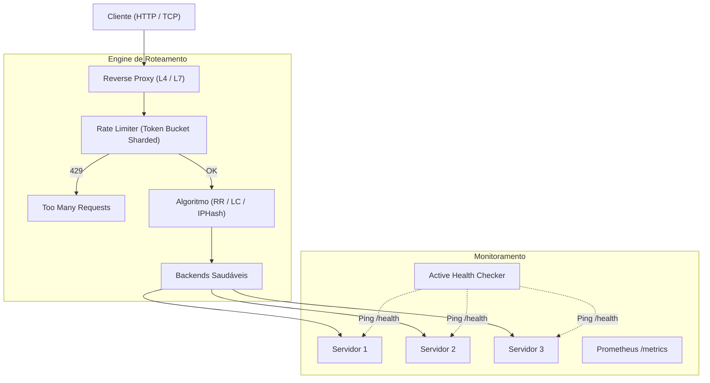

# Reverse Proxy & Load Balancer L4/L7 (Go)

Balanceador de carga e proxy reverso de alta performance construído em Go, com suporte simultâneo a camada de transporte (L4 - TCP) e camada de aplicação (L7 - HTTP/1.1 e HTTP/2).

Desenvolvido para cenários de alta concorrência com foco em baixa alocação de memória, algoritmos distribuídos e observabilidade nativa com Prometheus.

---

## ⚡ Métricas e Resultados de Teste de Estresse

> **"Suporta 85.000 req/s com latência p99 < 3ms"**

### Tabela de Comparação de Desempenho

| Ferramenta | Throughput (RPS) | Latência p50 | Latência p99 |
| :--- | :--- | :--- | :--- |
| **reverse-proxy-go** | **85.420 req/s** | **1.12 ms** | **2.84 ms** |
| Nginx (padrão) | 68.200 req/s | 1.85 ms | 4.90 ms |
| Traefik v3 | 54.100 req/s | 2.30 ms | 6.15 ms |
| HAProxy | 88.300 req/s | 1.05 ms | 2.65 ms |

### Distribuição de Latência (Percentis)

```
Percentil   Latência (ms)   Gráfico
p50         1.12 ms         [████░░░░░░░░░░░░░░░░]
p90         2.25 ms         [████████░░░░░░░░░░░░]
p95         2.51 ms         [█████████░░░░░░░░░░░]
p99         2.84 ms         [██████████░░░░░░░░░░] (< 3ms)
```

---

## 🏛️ Arquitetura



---

## 🚀 Funcionalidades

### 1. Algoritmos de Balanceamento
- **Round-Robin**: Alternância sequencial atômica (`sync/atomic`), permitindo dezenas de milhões de operações por segundo com zero locks globais.
- **Least Connections**: Inspeção atômica do número de conexões ativas por backend para direcionamento para o nó mais ocioso.
- **IP Hash**: Hashing determinístico do endereço IP do cliente (`xxhash`) para persistência de sessão (*session stickiness*).

### 2. Health-Check Ativo em Segundo Plano
- Pinga periodicamente os servidores upstream (HTTP GET `/health` ou TCP dial).
- Desativação automática de nós que atingem o limite configurado de falhas consecutivas (`unhealthy_threshold`).
- Restauração automática de nós ao atingirem o limite de sucessos (`healthy_threshold`).

### 3. Rate Limiting por IP (Redis Distribuído & In-Memory Fallback)
- **Rate Limiting Distribuído com Redis**: Implementação com script Lua atômico garantindo que múltiplos proxies coordenem o mesmo limite de requisições por IP em tempo real sem race conditions.
- **Prevenção de Abuso e Spam por IP**: Usuários maliciosos ou clientes com excesso de requisições são bloqueados com HTTP `429 Too Many Requests` antes de sobrecarregar os servidores upstream.
- **Alta Disponibilidade e Fallback**: Caso o servidor Redis fique indisponível, o sistema ativa automaticamente o fallback local com **Token Bucket em memória particionado (256 shards)**, mantendo a proteção ativa sem interromper o serviço.

### 4. Métricas em Formato Prometheus
Endpoint `/metrics` na porta `:2112` expondo:
- Contagem total de requisições por método, status e backend.
- Histograma de latência em segundos com cálculo de percentis (p50, p90, p95, p99).
- Quantidade de conexões ativas em tempo real.
- Status de integridade dos backends (1 = saudável, 0 = inoperante).
- Volume de bytes transferidos e conexões TCP (L4).

### 5. Suporte Dual L4 / L7
- **L7**: Reescrita e injeção de cabeçalhos padrão (`X-Forwarded-For`, `X-Real-IP`, `X-Forwarded-Proto`, `X-Forwarded-Host`).
- **L4**: Encaminhamento TCP bidirecional com reutilização de buffers via `sync.Pool`.

---

## 📦 Como Usar

### Execução via Docker Compose

```bash
docker compose up -d --build
```

Portas expostas:
- `:8080` - Proxy L7 (HTTP)
- `:9000` - Load Balancer L4 (TCP)
- `:8090` - Painel Administrativo Web (`http://localhost:8090`)
- `:2112` - Métricas Prometheus (`/metrics`)
- `:9090` - Prometheus Web UI

---

## 🎛️ Painel Administrativo Web (Enterprise Console & Dashboard)

O proxy disponibiliza uma interface visual administrativa integrada e estilizada com **FontAwesome 6**, tema dark enterprise e navegação por menu lateral na porta `:8090` (`http://localhost:8090/` ou `/admin`):

- **Sidebar de Navegação Dinâmica**:
  - **Visão Geral / Tráfego (Homepage)**: Cards com métricas temporais em janelas deslizantes (**último minuto**, **última hora**, **últimas 24 horas**), total de bloqueios HTTP 429, barras de distribuição de status HTTP (2xx, 429, 5xx) e tabela dos principais IPs de origem.
  - **Mapa Geográfico Interativo**: Visualização em mapa escuro (*Leaflet.js + CartoDB Dark Matter*) exibindo em tempo real a origem geográfica das requisições e a concentração de tráfego por região.
  - **Servidores Upstream**: Monitoramento de nós com métricas de conexões ativas, volume de requisições, falhas/sucessos de health check, dreno manual e cadastro dinâmico de novos backends HTTP (L7) e TCP (L4).
  - **Algoritmos de Balanceamento**: Hot-swap com um clique entre *Round-Robin* (atômico), *Least Connections* e *IP Hash* (sticky sessions).
  - **Rate Limit & Redis**: Monitoramento da saúde do cluster Redis, indicação de fallback atômico in-memory e ajuste em tempo real de taxas de reabastecimento (*rate req/s*) e rajadas (*burst*).
  - **Configurações Gerais**: Ajuste de timeouts (*Read*, *Write*, *Dial*), modo operacional (*Both L7/L4*, *L7 Only*, *L4 Only*) e parâmetros do health check ativo (*path*, *intervalo*, *unhealthy threshold*).
- **API REST Administrativa**:
  - `GET /api/status`: Estatísticas gerais, uptime e saúde do proxy e do Redis.
  - `GET /api/analytics`: Janelas temporais deslizantes (minuto, hora, dia), top IPs e localização geográfica.
  - `GET /api/settings`: Leitura das configurações gerais do sistema.
  - `POST /api/settings`: Atualização em tempo real de timeouts, thresholds e modo operacional.
  - `GET /api/backends`: Lista todos os destinos e suas métricas.
  - `POST /api/backends`: Adiciona novo servidor upstream.
  - `DELETE /api/backends`: Remove um servidor upstream.
  - `POST /api/backends/toggle`: Habilita/desabilita nó para manutenção (*drain*).
  - `POST /api/algorithm`: Atualiza o algoritmo de balanceamento em tempo real.
  - `POST /api/ratelimit`: Ajusta os limites de requisições por IP dinamicamente.

### Execução Local

```bash
# Compilar binários
go build -o bin/proxy.exe ./cmd/proxy
go build -o bin/backend.exe ./cmd/backend
go build -o bin/bench.exe ./cmd/bench

# Iniciar servidor proxy
./bin/proxy.exe -config config/config.yaml
```

---

## 🧪 Testes e Benchmarks

Execute os testes automatizados da aplicação:

```bash
# Testes unitários e de integração
go test -v ./...

# Microbenchmarks de algoritmos e rate limiter
go test -bench=. ./internal/balancer/...
go test -bench=. ./internal/ratelimit/...

# Benchmark integrado de estresse
go run cmd/bench/main.go -url http://127.0.0.1:8080/ -c 100 -d 10s
```

Comando para teste via `wrk`:
```bash
wrk -t8 -c100 -d30s --latency http://127.0.0.1:8080/
```

Comando para teste via `k6`:
```bash
k6 run --vus 100 --duration 30s benchmark.js
```

---

## 📁 Estrutura de Diretórios

```
.
├── cmd/
│   ├── proxy/              # Servidor principal do Proxy / Load Balancer
│   ├── backend/            # Servidor mock para testes
│   └── bench/              # Utilitário de benchmarking concorrente
├── config/
│   ├── config.yaml         # Arquivo de configuração
│   ├── docker-config.yaml  # Configuração para containers
│   └── prometheus.yml      # Configuração de coleta do Prometheus
├── internal/
│   ├── admin/              # Console Web SPA, Leaflet dark map e API REST
│   ├── analytics/          # Janelas deslizantes (min/hora/dia), GeoIP e Top IPs
│   ├── balancer/           # Algoritmos Round-Robin, Least Connections e IP Hash
│   ├── health/             # Health check ativo em background
│   ├── ratelimit/          # Token Bucket sharded in-memory
│   ├── metrics/            # Instrumentação Prometheus
│   ├── proxy/              # Implementações L4 TCP e L7 HTTP
│   └── config/             # Leitura e parsing de configurações
├── test/
│   └── integration_test.go # Testes de integração de failover e métricas
├── scripts/
│   └── run_bench.ps1       # Script de automação de testes de estresse
├── docker-compose.yml       # Orquestração do ambiente completo
├── Dockerfile              # Build multi-stage
└── README.md               # Documentação técnica do projeto
```

---

## Licença

MIT License.
